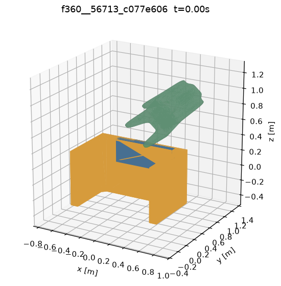
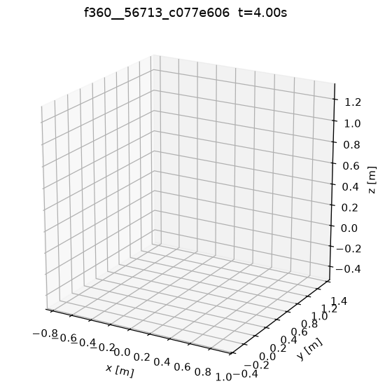
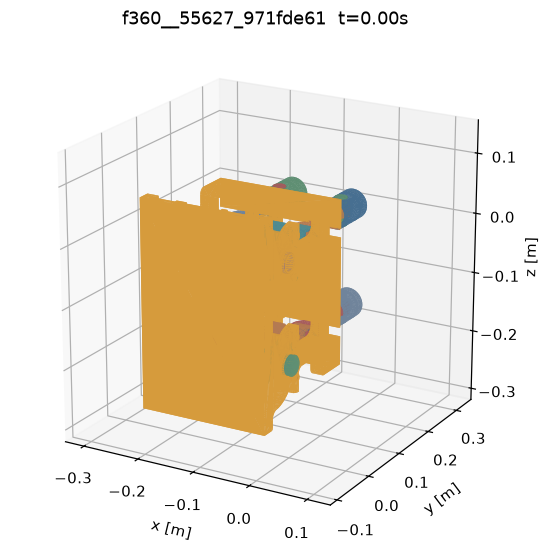
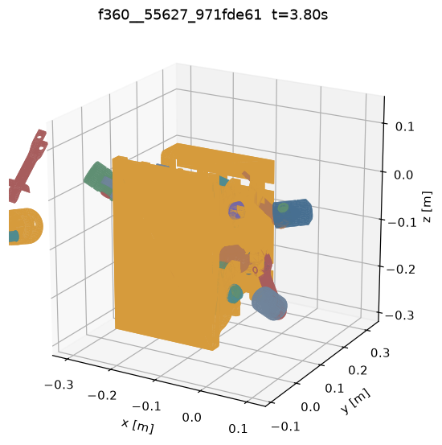
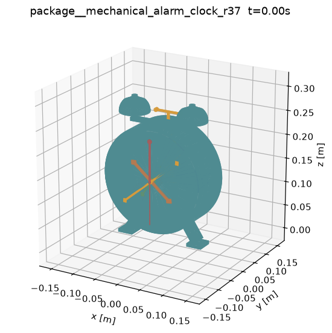
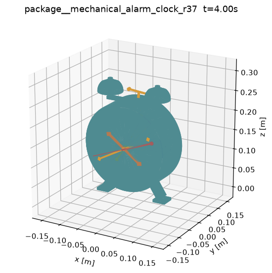
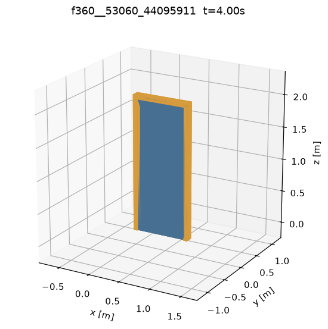
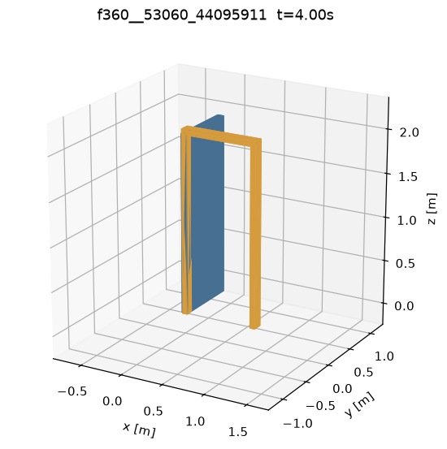

# 公开 CAD 数据集 vs simulation-ready 设计包：统一仿真环境对比（初稿）

日期：2026-09-02。数据：`runs/`（19 个 case 的 `sim_case.json`、`static/`、`drive/`、`contacts_t0.json`、`drive_nocontact/`），汇总表 `runs/summary.md`，协议 `unified_sim/PROTOCOL.md`。本文所有"实测"数字均来自这些文件；没有跑过的东西不写。

## 1. 问题与口径

公开 CAD 装配数据集（Fusion 360 Gallery、AutoMate）是为几何学习建的，不是为仿真建的。我们想回答的是一个窄问题：**把数据集里和我们机构族相同的装配，与我们的 simulation-ready 设计包放进同一个中立刚体仿真环境，按同一套规则跑，各自能不能立住、能不能动。** 判据在跑任何 case 之前冻结（PROTOCOL §4/§5）：

- 静置关：无输入、重力 \([0,0,-9.81]\)、4 s；任一非接地体质心位移 > 10 mm、或出包围盒、或数值发散 → COLLAPSE，否则 STABLE。
- 微驱动关：静置 STABLE 的 case，对第一个可动关节施加与被驱动体质量成比例的小载荷（转动 \(\tau = 0.5\,m g L\)，平动 \(F = m g\)），4 s；关节坐标正向走够 0.175 rad / 10 mm 且无明显偏轴 → MOTION_OK，走不够 → MOTION_DEAD，反向/偏轴/发散 → MOTION_ERRATIC。

适配器只做翻译：不补关节、不加接地、不启用源数据没启用的限位；数据集声明了但我们不支持的特征（平面/球/销槽关节、齿轮/齿条啮合关系）如实记入 `unsupported_features`，两边同规则（齿轮啮合第一轮两边都不仿真）。

## 2. 样本

| 来源 | 抽样口径 | 入选 | 说明 |
|---|---|---|---|
| Fusion 360 Gallery | `a1.0.0_04` 卷全量 751 个装配（11 卷之一，约 9%） | 8 | 齿轮系 2、铰链+滑块 4、纯铰链 2；每个都渲染复核过（`screening/f360_m2_selection.md`） |
| AutoMate | 29,781 个规模适中的装配池中随机抽 100 个画像，再按机构签名选 | 8 | 真齿轮系 3（靠 GEAR mateRelation 找到，圆柱面启发式 7 中只有 1 个是真齿轮）、铰链+滑块 3、纯铰链 2 |
| 我们的设计包 | — | 3 | `mechanical_alarm_clock_r37`（齿轮轮系主选）、`rack_pinion_gate_r01`（TASK_CERTIFIED 认证样例）、`four_bar_wiper_v1`（铰链/连杆对照） |

## 3. 结果

### 3.1 终态（19/19，无 NOT_RUN）

| | STABLE | COLLAPSE | 微驱动 OK | 微驱动 DEAD |
|---|---|---|---|---|
| F360（8） | 4 | 4 | 0 | 4 |
| AutoMate（8） | 7 | 1 | 0 | 7 |
| 我们的包（3） | 3 | 0 | 3 | 0 |

逐 case（缩写 id 与完整 id 的对照见 `runs/summary.md` 末尾）：

| case | 机构 | 静置 | max 位移 | 机制 | 微驱动 | 运动量 / 阈值 |
|---|---|---|---|---|---|---|
| f360__56713 | 书桌 + 抽屉 + 椅子 | COLLAPSE | 78.50 m | 无接地体，整体自由落体 | – | – |
| automate__16a49d23 | 两簇铰接夹爪 | COLLAPSE | 78.51 m | 无 fixed 体，整体自由落体 | – | – |
| f360__55627 | 行星齿轮柱塞泵（66 体） | COLLAPSE | 57.20 m | 17 个未关节化垫圈/齿轮掉落；41 个关节化体位移 > 10 mm（柱塞 0.1–0.5 m）；t = 3.9 s 数值发散 | – | – |
| f360__56430 | 曲柄 + 手柄 + 连杆 | COLLAPSE | 8888.7 m | 曲柄–手柄–连杆环 t = 3.0 s 数值发散，连杆飞出；3 个未关节化体 | – | – |
| f360__53631 | 两轮车 | COLLAPSE | – | t = 0.029 s 数值发散（座管连接件） | – | – |
| f360__53060 | 单铰链门 | STABLE | 0.0 mm | 限位 [0, π/2] 生效 | DEAD | +0.001 / 0.175 rad |
| f360__60738 | 平行双摇杆四连杆 | STABLE | 0.0 mm | | DEAD | +0.001 / 0.175 rad |
| f360__58066 | 圆鼓内四片扇形滑瓣 + 旋钮 | STABLE | 0.0 mm | 5 个滑块限位生效 | DEAD | +0.2 / 10 mm |
| f360__53744 | 杠杆锁扣 | STABLE | 3.1 mm | 限位生效 | DEAD | +0.0 / 10 mm |
| automate__57555ede | 内齿圈 + 三齿轮 | STABLE | 0.0 mm | | DEAD | +0.025 / 0.175 rad |
| automate__9657d303 | 三轴三齿轮 | STABLE | 0.0 mm | | DEAD | +0.064 / 0.175 rad |
| automate__ab2d902d | 大齿圈 + 小齿轮 + 摆臂 | STABLE | 0.0 mm | | DEAD | +0.005 / 0.175 rad |
| automate__072a9a43 | 台虎钳（丝杠 + 滑块钳口） | STABLE | 0.0 mm | | DEAD（临界） | +0.170 / 0.175 rad |
| automate__216064bc | 杠杆压紧机构 | STABLE | 0.0 mm | | DEAD | +0.002 / 0.175 rad |
| automate__7305d8b7 | 手动压力机 | STABLE | 0.2 mm | | DEAD | +0.001 / 0.175 rad |
| automate__109d26e5 | 双滚筒连杆 | STABLE | 6.1 mm | | DEAD | +0.129 / 0.175 rad |
| package__mechanical_alarm_clock_r37 | 闹钟齿轮轮系 | STABLE | 2.1 mm | | **OK** | +13.28 / 0.175 rad |
| package__rack_pinion_gate_r01 | 齿轮齿条门 | STABLE | 1.0 mm | | **OK** | +1.91 / 0.175 rad |
| package__four_bar_wiper_v1 | 四连杆雨刮 | STABLE | 0.0 mm | 限位 [−0.2, 2.2] 生效 | **OK** | +1.13 / 0.175 rad |

 

*f360__56713：椅子在源数据里就是悬空的，且整个装配没有接地体；4 s 后全部离开视野。*

 

*f360__55627：14 个平面关节我们不支持（如实记录）、17 个零件没有任何关节，垫圈和齿轮从泵壳里掉出来。*

 

*package__mechanical_alarm_clock_r37：静置 2.1 mm 内，微驱动下发条轴转了 13.3 rad。*

### 3.2 数据集侧 COLLAPSE 的机制（5 个）

- **没有接地体（2 个）**：f360__56713、automate__16a49d23。源数据没有把任何零件标为固定/接地，整体以 \(\tfrac12 g t^2 = 78.5\) m 自由落体。AutoMate 抽样池里 52% 的装配没有 fixed 锚定，F360 可动装配里 83/95 没有锚定（`screening/INTERSECTION.md`），这是最普遍的一类。
- **零件没有关节（1 个决定性 + 2 个叠加）**：f360__55627 的 17 个未关节化体（垫圈、一只齿轮、一个衬套）直接掉落；56430 也有 3 个未关节化体。这是"mate ≠ 动力学关节"的直接后果：设计者用几何重合摆好了零件，但没有声明约束。
- **数值发散（3 个）**：53631 在 0.029 s、56430 在 3.0 s、55627 在 3.9 s 出现非有限位姿。三者共同点是零间隙的配合面 + 闭环/多约束（56430 的曲柄–手柄–连杆环、53631 的车轮–车架–座管）。对 53631 另做过一组探索性检查（结果未入库）：把关节的体顺序、轴符号或锚点位置任一项换回旧表示，都得到不同形式的爆炸（最大位移 116 m ~ 1572 m），即这个装配在刚体接触仿真里本来就不可积，不是某个表示细节造成的。

t = 0 时我们没有观察到大穿透：19 个 case 的最大初始穿透都 ≤ 8×10⁻⁸ m（`contacts_t0.json`）。发散不是"零件一开始就叠在一起"，而是零间隙配合在运动中与理想关节互相打架。

### 3.3 数据集侧"立得住但动不了"的机制（11 个全部 MOTION_DEAD）

这是本轮最主要的发现，也是 HANDOFF §4.2 预判的口径：**多数数据集模型能定住，但一驱动就卡死，没有任何功能验收闭环。** 11 个 STABLE 的数据集 case 里 10 个在 4 s 内转角 ≤ 0.13 rad / 位移 ≤ 0.2 mm，只有台虎钳 072a9a43 转到 0.170 rad，卡在 0.175 阈值下。

归因用了两个不改判定的诊断（PROTOCOL §7a）：

1. **t = 0 接触报告**：11 个 case 里 7 个的被驱动关节对在初始位姿就有距离 |d| < 10⁻⁷ m 的接触点（配合面完全重合，零间隙：53060、53744、60738、109d26e5、216064bc、7305d8b7、ab2d902d）；58066 的滑槽间隙 1 µm，9657d303 的轴承 42 µm，072a9a43 的螺纹面 0.13 mm；57555 的被驱动齿轮与接地体没有直接接触，但与邻接齿轮的 3 个零件对共有 629 个零距离接触点（零侧隙啮合）。我们 3 个包的被驱动关节对在 t = 0 没有任何接触点（间隙大于 0.1 mm 的接触包络）；全装配范围内最近的零件对，闹钟 3 µm（两只齿轮，非关节对）、雨刮 60 µm、齿轮齿条门无接触。
2. **只关掉被驱动关节这一对零件之间的接触再驱动**（其余接触全部保留）：

| case | 协议驱动 | 去掉该对接触后 | 读法 |
|---|---|---|---|
| f360__53060 门 | DEAD +0.001 rad | **OK，转到 π/2 限位** | 铰链和作者限位都对，门板与门框零间隙卡死 |
| automate__072a9a43 台虎钳 | DEAD +0.170 rad | **OK** +680 rad | 丝杠与钳口螺纹零间隙，摩擦拖住 |
| automate__7305d8b7 压力机 | DEAD +0.001 rad | **OK** +0.23 rad | 杠杆轴与机架零间隙 |
| automate__9657d303 三齿轮 | DEAD +0.064 rad | **OK** +0.42 rad | 轴承零间隙；去掉后仍被零侧隙啮合拖慢 |
| f360__58066 滑瓣 | DEAD +0.2 mm | OK +10.9 mm | 滑槽零间隙 |
| f360__60738 四连杆 | DEAD +0.001 rad | ERRATIC +5.4 rad | 铰链本身能转，但转起来后其余零间隙铰链偏轴 |
| automate__57555ede 内齿圈轮系 | DEAD +0.025 | DEAD +0.025 | 卡点不在轴承，在零侧隙啮合的齿 |
| automate__ab2d902d 齿圈 + 小齿轮 | DEAD +0.005 | DEAD +0.004 | 同上 |
| automate__216064bc 杠杆压紧 | DEAD +0.002 | DEAD +0.001 | 被驱动铰链两端都在零间隙滑槽里，卡点在滑槽 |
| automate__109d26e5 双滚筒连杆 | DEAD +0.129 | DEAD −0.048 | 驱动力矩按体质量给的很小，重力项占优；不是卡死 |
| f360__53744 锁扣 | DEAD 0.0 mm | DEAD 0.0 mm | 作者限位 [−10 mm, 0]：插销在授权位置的正向行程为零 |

 

*f360__53060：左为协议驱动（637 N·m，门板转 0.001 rad），右为诊断（门板与门框不接触时转到 90° 限位）。*

结论：数据集侧的 MOTION_DEAD 里 6 个是**配合面零间隙把关节卡死**，2 个是**零侧隙齿轮啮合卡死**，1 个是相邻零间隙滑槽卡死，1 个是重力项占优的小载荷判据，1 个是作者限位在驱动方向上没有行程。11 个里没有一个是"关节本身映射错了"——去掉接触后关节都按声明的自由度运动。

### 3.4 我们的包为什么过

三个包都 STABLE + MOTION_OK，且协议驱动与去接触驱动的数字完全相同（1.129 / 13.280 / 1.914 rad）——被驱动关节对在 t = 0 就没有接触，接触在这些关节上不承载。这不是仿真器偏心：同一 runner、同一重力、同一判定函数，差别只在输入。设计包在 harness 的门禁里被要求给出显式的接地刚体组、每个可动关节的轴与限位、以及配合间隙；这些正是数据集模型缺的东西。

### 3.5 预测 vs 实测

筛选阶段对每个样本预判了死因（`screening/*_final_samples.json`），对照如下：

| 判定 | 数量 | case |
|---|---|---|
| ✓ 如预测 | 8 | 56713（悬空 + 无接地）、16a49d23（无 fixed）、55627（悬空件 + 限位未启用）、56430（悬空件）、53631（限位未启用→实际是数值发散，方向对、机制不对）、3 个包 |
| △ 预测"无死因"，实测立得住但驱动不动 | 9 | 53060、58066、53744、57555ede、9657d303、072a9a43、216064bc、7305d8b7、109d26e5 |
| ✗ 预测落空（预测会散，实测立得住） | 2 | 60738（预测"限位未启用"，实际四连杆靠零间隙接触卡住不动）、ab2d902d（预测"圆柱面被当齿轮"，实际是真齿轮，立得住） |

落空的两条如实列出。更重要的是 9 条 △：筛选阶段的死因分类只看关节/接地/限位的**声明**，看不出"配合零间隙"这一层——它需要真的跑接触仿真才暴露出来。这也是这套统一环境比静态画像多出来的信息。

## 4. 结论口径

- 公开数据集不保证 sim-ready：16 个和我们机构族相同的样本里，5 个在无输入重力下散架或发散，11 个能定住但在最小驱动下全部卡死；卡死的直接原因是零间隙配合与零侧隙啮合，根源是这些模型为几何而建，从未被要求通过任何物理验收。
- 我们的流程把 sim-ready 变成可验收、可追溯的东西：3 个包在同一环境下静置 ≤ 2.1 mm、驱动全部按声明的自由度运动，且每一步的输入（`sim_case.json`）、轨迹、判定和诊断都落盘可查。
- 认证级背书只挂 `rack_pinion_gate_r01`（harness 官方判卷 TASK_CERTIFIED，复放命令见 §6）。闹钟包 r37 在官方判卷里是 PHYSICAL_PREFLIGHT_FAILED（闹铃锤动态轨迹与理想参考差 0.093 rad，阈值 0.045），这里只能说"能立能跑"，不能称"已认证"。

## 5. 限制（Limitations）

- 抽样口径：F360 是 11 卷中 1 卷（751 个装配）的全量筛选；AutoMate 是 29,781 池中抽 100。样本量 8 + 8，是案例对比，不是统计结论。
- 齿轮/齿条/螺纹啮合两边都不仿真（第一轮协议）。啮合力只通过齿面接触传递；数据集侧零侧隙齿轮因此卡死，我们的闹钟包驱动的是发条轴，未直接检验啮合传动。
- 零间隙配合在三角网格接触里会被放大：网格离散把圆柱配合变成多边形配合，名义零间隙在数值上就是干涉。物理上零间隙配合本来也转不动，但"卡多死"的程度不能直接换算成真实装配。
- 微驱动只沿关节声明的正向施加。53744 的插销在授权位置正向行程为零，被判 DEAD；反向驱动会得到不同结果。该规则对两边一致，但对"静止在行程端点"的机构偏严。
- F360 限位以 `rest_value` 作为授权位姿的坐标（数据集不导出当前关节值）；F360 圆柱关节的限位、as-built 非刚性关节未应用，样本里都没出现。
- 数值发散的 3 个 case 在协议下都算 COLLAPSE；它们在真实物理里未必"散架"，更准确的说法是"这个模型在刚体接触仿真里不可积"。
- 数据集的质量属性统一按 1000 kg/m³ 取，源数据的质量只记录不使用（AutoMate 的质量是密度 1 的占位值）。
- "Arti3D" 指代未确认，未纳入。

## 6. 复放

```bash
cd /home/genlab/simulation-ready-cad-harness/comparison_demo
python3 unified_sim/run_all.py build      # 19 个 case 的中立输入（sr-cad 环境，约 1 分钟）
python3 unified_sim/run_all.py simulate   # 静置 + 微驱动，串行，约 70 分钟；15 GB 内存一次一个 case
python3 unified_sim/run_all.py render     # 关键帧 PNG
python3 unified_sim/run_all.py summary    # runs/summary.{json,md}

CHRONO=/home/genlab/.micromamba-simulation-ready/envs/sr-chrono-py312
$CHRONO/bin/python unified_sim/diagnostics.py contacts runs/*/                 # t=0 接触报告
$CHRONO/bin/python unified_sim/diagnostics.py nocontact-drive runs/*/          # 去接触驱动（仅 STABLE case）
```

认证样例（harness 官方判卷，约 6 分钟）：

```bash
cd /home/genlab/simulation-ready-cad-harness
ENV=/home/genlab/.micromamba-simulation-ready/envs/sr-cad-py312
CHRONO=/home/genlab/.micromamba-simulation-ready/envs/sr-chrono-py312
LD_LIBRARY_PATH=$ENV/lib $ENV/bin/python -m simulation_ready_cad_workflow.validation_pipeline.benchmark.run \
  --bundle .benchmarks/rack_pinion_gate_r01 --scratch /tmp/replay_r \
  --pychrono-executable $CHRONO/bin/python --require-match
```

## 7. 协议修正记录

判据数字（§4/§5 的 10 mm、0.175 rad、10 mm、偏轴上限）自冻结起未改。修正案全文在 `unified_sim/PROTOCOL.md` §8，本轮新增：

- **A7 落地**：源数据启用的关节限位由 runner 强制执行（`ChLinkLock` LimitRz / LimitZ，作用于 body_b 相对 body_a 的关节坐标）。影响 F360 58066/53744/56713/53060 与四连杆雨刮包。
- **A8 F360 关节帧**：关节轴取自 side-two 关节坐标系中由 `rotation_axis` / `slide_direction` 指定的轴（此前一律取 side-one 的主轴，58066 的 5 个面内滑块和 53744 的滑块被当成法向，37 个 `is_flipped` 关节符号反了）；`as_built_joints` 中的刚性关节并入刚体（53744 的 7 个、55627 的 4 个，此前被忽略导致零件悬空）；圆柱关节以 `cylindrical`（`ChLinkLockCylindrical`）直出而不再退化为铰链（56430 ×2、55627 ×8）。
- **A9 关节电机**：驱动载荷成对施加（+body_b / −body_a），运动量按关节坐标测量。此前只对一侧施力并测其世界转角，结果取决于适配器把哪个零件写成 body_b（072a9a43 的力矩落在被滑槽锁住的钳口上，钳口丝杠一动没动）。
- 全部 19 个 case 在 A7–A9 后重建、重跑；本文所有数字来自这次重跑。
